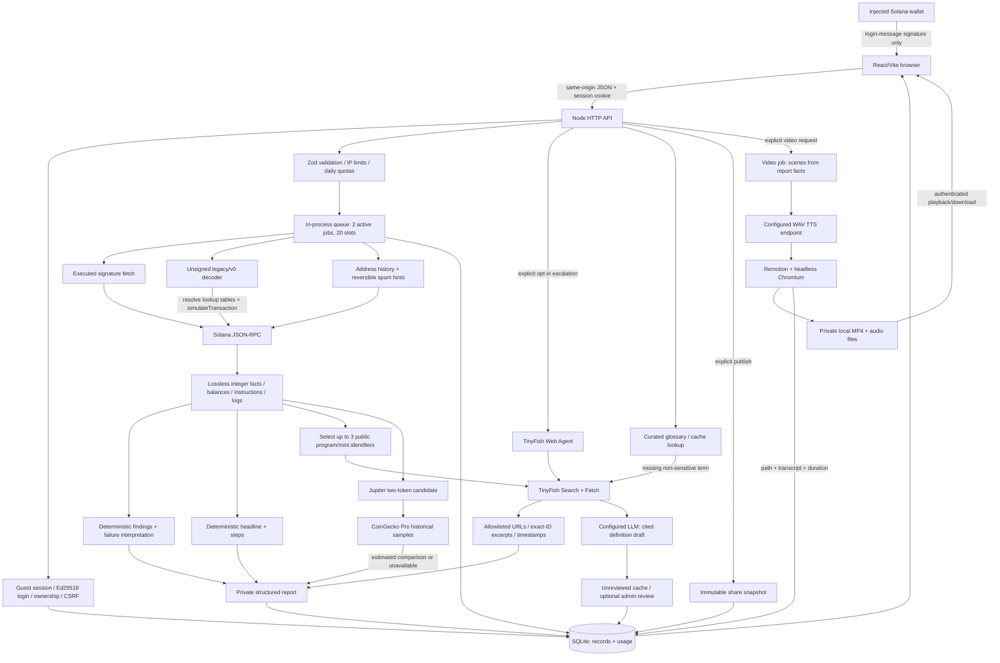

# TrustLens: implemented architecture



The API, queue, and orchestrators currently run in one Node process. Remotion launches Chromium for rendering; the diagram does not imply independently deployed microservices. No broadcast RPC call exists. Transaction explanation does not call the LLM: exact facts are formatted deterministically. The LLM is limited to non-sensitive missing glossary definitions.

## Libraries and responsibilities

| Library                                               | Why it is used                                                                          |
| ----------------------------------------------------- | --------------------------------------------------------------------------------------- |
| Node `http`, native `fetch`                           | API server and bounded outbound requests without a framework or provider SDK            |
| Node `sqlite`                                         | Local persistent records and usage counters                                             |
| Node `crypto`                                         | Random tokens, SHA-256 lookup keys/digests, Ed25519 login verification                  |
| `@solana/web3.js` 3.1.1                               | Deserialize versioned transactions and resolve account/lookup structures                |
| `bs58`                                                | Encode/decode public addresses, transaction IDs, instruction bytes and login signatures |
| `lossless-json` + native `BigInt`                     | Preserve RPC integers beyond JavaScript's safe-number range                             |
| `zod`                                                 | Strict API input and generated-definition shape validation                              |
| `remotion`, `@remotion/bundler`, `@remotion/renderer` | React animation composition, bundling, H.264 MP4 rendering                              |
| Node `test`, `assert`                                 | Automated fixtures and HTTP integration tests                                           |

## Provider contracts

- Solana: `getTransaction`, `getSignaturesForAddress`, `getAccountInfo`, `getMultipleAccounts`, `getTokenAccountsByOwner`, `isBlockhashValid`, `simulateTransaction`. Default endpoints are public mainnet/devnet; production should configure an appropriate provider.
- TinyFish Search: GET `https://api.search.tinyfish.ai` with query and domain filter. Fetch: POST `https://api.fetch.tinyfish.ai` with bounded URL lists. Agent: optional POST `https://agent.tinyfish.ai/v1/automation/run`. Keys stay server-side.
- LLM: operator-configured OpenAI-compatible chat/completions endpoint. No provider or model is selected by default. Only glossary definitions are generated; a matching verbatim supporting excerpt is required, and this does not equal human review.
- TTS: operator-configured OpenAI-compatible audio/speech endpoint returning WAV. No provider/model/voice selected by default.
- CoinGecko Pro: `/api/v3/coins/{id}/market_chart/range`; only mapped mainnet wrapped SOL/USDC benchmarks, with samples within five minutes of execution. Numeric USD values are approximate.

## Authentication sequence

```mermaid
sequenceDiagram
  participant B as Browser
  participant A as TrustLens API
  participant W as User wallet
  participant D as Database
  B->>A: GET /api/session
  A->>D: Store hash of random session token + guest owner
  A-->>B: HttpOnly cookie + CSRF token
  B->>W: Connect on user's sign-in action
  W-->>B: Public address
  B->>A: POST challenge(address), cookie + CSRF + Origin
  A->>D: Save one-use message, nonce, five-minute expiry
  A-->>B: Exact domain/address-bound login message
  B->>W: signMessage(exact bytes)
  W-->>B: Signature, if user approves
  B->>A: POST verify(signature)
  A->>D: Consume challenge
  A->>A: Verify Ed25519 against challenge public key
  A->>D: Associate guest records with wallet owner; rotate session
  A-->>B: New cookie + CSRF token, seven-day expiry
```

This is a custom domain-bound message-signing flow. Full Wallet Standard SIWS feature negotiation and WalletConnect are not implemented. A public address alone never authenticates ownership. No passwords, seed phrases, wallet private keys, or login signatures are persisted. Authenticated sessions are required for saving account features; public transaction analysis works as a guest.

## Database contents

There are two physical tables today, not a fully normalized relational schema:

1. `records(kind,id,owner,data,updated)` holds JSON records with a kind/id primary key and kind/owner index.
2. `usage(subject,day,category,count)` holds atomic daily counters for owner IDs and hashed socket IPs.

Record kinds:

| Kind              | Stored content                                                                                                                                                                  |
| ----------------- | ------------------------------------------------------------------------------------------------------------------------------------------------------------------------------- |
| session           | Hashed cookie-token lookup ID, owner, public wallet address if signed in, CSRF token, expiry                                                                                    |
| challenge         | Exact login message, address, nonce, expiry; deleted on verification attempt                                                                                                    |
| owner_alias       | Guest-to-wallet ownership mapping used during in-flight job migration                                                                                                           |
| job               | Owner, type, queue stage/status, timestamps, sanitized error or result IDs                                                                                                      |
| report            | Decoded instruction bytes/fields, public addresses, integer changes/fees, logs, simulation observations, findings, explanations, evidence excerpts, trade estimates, saved flag |
| share             | Random public link ID and immutable report snapshot; explicit publication only                                                                                                  |
| research          | Exact-identifier source excerpts, URLs, timestamps and cache status                                                                                                             |
| glossary          | Definitions, examples, aliases through code, review state, source URL/excerpt, version and evidence hash                                                                        |
| glossary_revision | Previous definition version when reviewed or retired                                                                                                                            |
| video             | Private local file path, owner/report relationship, transcript, duration                                                                                                        |
| watchlist         | Wallet owner, public address, cluster, label                                                                                                                                    |
| preferences       | Spam and glossary display preferences                                                                                                                                           |

The complete unsigned serialized transaction stays in request/job memory and is not persisted. Its decoded content and message digest are saved in the report. MP4/WAV binaries live on disk, not in SQLite. API keys live in environment configuration.

## Deployment recommendation

For live users, migrate application records to **Neon Postgres** and media to private object storage. Keep the Node API and a separate long-running video worker, and use a durable job queue before scaling to multiple instances. Neon supports standard Postgres connections and pooled application connections; use direct connections for migrations where required. See [Neon's connection guide](https://neon.com/docs/get-started/connect-neon).

The migration requires an async store refactor, relational migrations/constraints, transactional quota updates and owner migration, and deployment tests. A DATABASE_URL variable alone does not switch the current implementation. PostgreSQL does not provide the application's job scheduling, MP4 storage, or Chromium runtime.

SQLite remains sufficient for a single-process demo with a persistent disk. Before public launch, also add intentional retention/cleanup, backup policy, trusted-proxy or ingress rate limiting, paid-provider acceptance checks, and real wallet-extension acceptance testing. No deployment or Neon database was created in this implementation.
