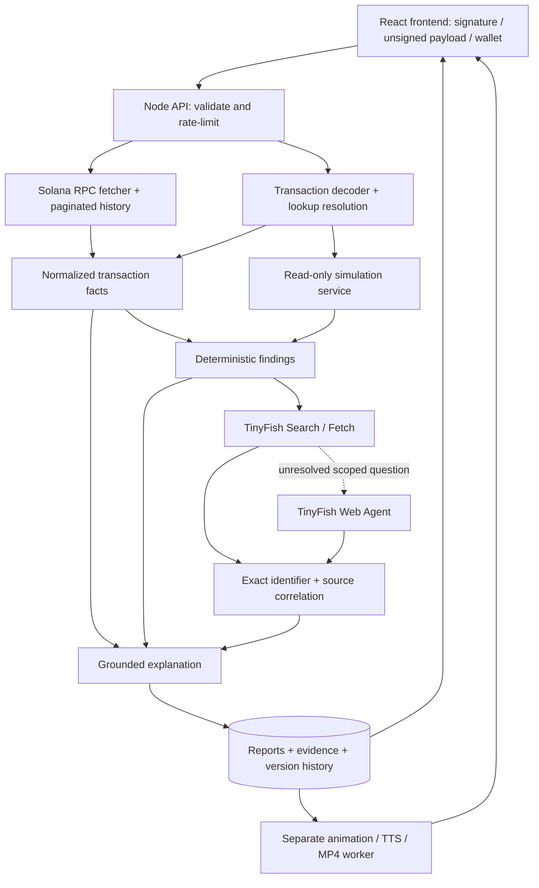

# TrustLens — Solana transaction intelligence

**Track:** Web3 · **Primary chain:** Solana  
**Product:** Transaction explainer, investigator, and pre-signature risk review.  
**Brand:** TrustLens

> Understand what happened. Inspect what you are authorizing. Follow the evidence.

## 1. Product decision

Build one shared transaction-analysis engine with three entry points: an executed transaction signature, an unsigned serialized transaction, and a public wallet address. The primary differentiator is a traceable connection between decoded behavior and external evidence about exact token mints and programs.

Solana RPC establishes transaction facts. Simulation estimates execution against a specific state. TinyFish investigates public sources. An explanation service makes this understandable without changing or inventing the underlying facts.

The analysis engine is read-only. It never asks for seed phrases, signs transactions, approves spending, or broadcasts transactions. Optional account login asks the user's wallet to sign a clearly separated authentication message. It is a review tool, not a universal scam detector, audit, or investment recommendation.

## 2. Users and concrete journeys

- **Everyday wallet user:** Pastes an unfamiliar signature and learns what moved, who paid fees, what programs ran, and what remains undecoded.
- **User reviewing a dApp action:** Supplies an unsigned payload and intended action. Reviews requested permissions, simulation results, and identity evidence before returning to their wallet.
- **Support agent or community educator:** Investigates a public wallet or transaction, then shares a dated explanation with citations and, later, a narrated video.

Do not imply that connecting a wallet intercepts another dApp's transaction. The first release accepts explicitly supplied base64 payloads. A later SDK can let cooperating dApps send the exact serialized message for review. Wallet-wide interception would require a separate wallet/extension integration.

## 3. Current repository versus intended product

The repository contains the React/Vite frontend and a Node 24 ES-module backend with schema validation, SQLite storage, a bounded job queue, provider adapters, and a Remotion rendering worker. Preserve the established blue/white editorial design and TrustLens identity.

| Capability                       | Current frontend                                    | Backend delivery required                                             |
| -------------------------------- | --------------------------------------------------- | --------------------------------------------------------------------- |
| Three investigation modes        | Submits live jobs and polls real stages             | Implemented: RPC retrieval and legacy/v0 deserialization              |
| Plain-English explanation        | Real reports plus separately labeled samples        | Deterministic explanations from normalized facts                      |
| Selectable technical definitions | API-backed glossary popovers                        | 30 curated terms, aliases, cited generation, caching and admin review |
| Pre-signature review             | Unsigned payload and structured SOL intent controls | Decode, lookup resolution, simulation, digest, findings               |
| Wallet history                   | Live pages and reversible likely-spam filter        | Address-reference pagination; complete wallet indexing remains future |
| TinyFish evidence                | Exact-ID excerpts, URLs and timestamps              | Search/Fetch, cache, optional agent; credentials required             |
| Trade comparison                 | Explicit estimated/unsupported/unavailable states   | Conservative Jupiter two-token candidate, SOL/USDC historical mapping |
| Sharing                          | Explicit publish action and standalone share page   | Private report storage, immutable snapshots and revocation            |
| Video and MP4                    | Queued generation and download                      | Remotion + WAV TTS adapter; credentials and browser required          |

Never display an arbitrary submitted input with fictional findings as though it was analyzed. Samples are separate. Live analysis uploads inputs to the backend/RPC; selected public mint/program identifiers go to TinyFish. Provider failures remain visible. Removed pricing is not replaced with unvalidated commercial claims.

## 4. Scope and priorities

### P0 — a working vertical slice

1. Retrieve a real executed Solana transaction by signature and selected cluster.
2. Normalize supported SOL and legacy SPL Token transfers, fees, approvals, and relevant account changes.
3. Produce a factual headline, step-by-step explanation, exact raw amounts, and unsupported-instruction warnings.
4. Accept a base64 unsigned transaction, fully deserialize it, resolve account addresses, simulate without broadcasting, and present findings.
5. Integrate TinyFish Search and Fetch server-side for one exact token/program investigation with visible source evidence.
6. Handle RPC errors, missing metadata, unsupported versions, research failures, and partial results honestly.

### P1 — requested core product completeness

- At least one explicitly supported swap decoder/route and historical trade comparison.
- Failure explanation grounded in error code, instruction index, and available logs.
- Wallet history with cursor pagination, explicit coverage, and reversible likely-spam filtering.
- Shareable dated reports with user-initiated publication and clear disclosure.
- Expanded glossary and raw amount/details controls.

### P2 — requested media experience

- An animated, narrated explainer accompanying each supported completed transaction report.
- Browser playback and MP4 download.
- Optional bounded TinyFish Web Agent escalation.
- Broader swap/program and Token-2022 coverage.

Videos are part of the intended product, not silently discarded. Deliver them after factual parsing and review are reliable. A failed render must not block reading the report. Unknown instructions remain visibly unknown in both narration and animation.

## 5. Architecture

Implemented stack: Node 24 HTTP API in JavaScript ES modules, Zod request schemas, Solana web3.js 3.1.1, lossless RPC JSON parsing, SQLite, and a bounded in-process queue. This matches the repository's JavaScript tooling. PostgreSQL and an external queue are migration options for multi-instance hosting. Use an archival-capable RPC provider for history; public RPC does not promise production throughput or complete coverage.

Modules: `transaction_fetcher`, `transaction_parser`, `simulation_service`, `risk_rules`, `tinyfish_client`, `evidence_correlator`, `explanation_service`, `report_service`, `wallet_history`, `market_comparison`, and `video_service`. These can be modules in one service, not separate microservices. Video runs separately because rendering is expensive.

## 6. Solana correctness contract

### Executed transactions

- Validate signatures as base58 decoding to 64 bytes, public addresses to 32 bytes, and selected cluster independently. Format validation does not prove existence or ownership.
- Use `getTransaction` with an explicit commitment and supported transaction version. A null response means not found at that commitment/provider, not necessarily nonexistent.
- Handle legacy and v0 transactions. Resolve address lookup table keys using returned loaded addresses where appropriate, or fetch lookup accounts. Preserve account index ordering and inner instruction ancestry.
- Parse native transfers, supported SPL Token instructions, associated token account creation, rent-related lamport changes, closures, and wrapped SOL carefully. Avoid counting an instruction, inner transfer, and net balance delta as three movements.
- Separate requested instructions from actual effects. A failed transaction may still incur a fee; do not animate failed transfer instructions as completed fund movements.
- Unsupported instructions stay in the timeline with program ID and raw-reference provenance. Familiar program IDs do not certify all invocations.

### Exactness

Represent lamports, token quantities, allowances, and fees as integer decimal strings at API/storage boundaries and BigInt during computation. Use a lossless JSON ingestion path where the upstream sends integers beyond JavaScript's safe range; converting an already-rounded Number into BigInt cannot repair it.

Format token quantities using verified decimals and string arithmetic. Always offer full raw units. Rounded presentation must be labeled and expandable. Account rent, network fees, swap amounts, transfer fees, and USD estimates remain distinct fields.

Do not claim that every figure is exact: base units can be exact; USD values, historical benchmarks, impact estimates, and simulated future outcomes have limitations.

### Unsigned review

- Define input as a serialized Solana transaction in canonical base64, with signature slots as required by the wire format. Enforce the supported wire-size limit, reject invalid structure, unsupported versions, inconsistent accounts, and invalid indexes. Client encoding validation is only an initial check.
- Record cluster, fee payer, required signers, exact message digest, program IDs, instruction data, destinations, token mints, authorities, and user-stated intent.
- Legacy and v0 address resolution must succeed for complete review. Unresolved accounts produce an incomplete report.
- Simulate with signature verification disabled for unsigned payloads. Prefer the original blockhash when valid. If a refresh uses `replaceRecentBlockhash`, label it as a modified simulation environment and retain the original digest. Do not combine incompatible settings.
- Record commitment, simulation slot, blockhash treatment, returned errors/logs, and inspected accounts. Fetch necessary pre-state and request post-state where supported. Since reads can observe different slots, record that limitation; do not imply guaranteed atomic snapshots.
- Do not invent expected balance deltas when the simulation provider did not return sufficient account state. A timeout is inconclusive, not a simulated failure.
- Durable nonce transactions require an explicit adapter or an unsupported warning; never silently replace their nonce behavior.
- A report applies only to the recorded payload and state. Any changed payload needs a new review. For future dApp integrations, compare the digest before presenting the report alongside wallet approval.

### Rules, not an opaque score

Initial finding codes: `INTENT_OUTFLOW_MISMATCH`, `DELEGATE_APPROVAL`, `AUTHORITY_CHANGE`, `ACCOUNT_CLOSE`, `UNKNOWN_PROGRAM`, `UNSUPPORTED_INSTRUCTION`, `SIMULATION_FAILED`, `SIMULATION_UNAVAILABLE`, `BLOCKHASH_STALE`, `MINT_IDENTITY_UNVERIFIED`.

Approval analysis is Solana-specific: show the token account, delegate, and exact allowance. A very large u64 allowance is not literally infinite. Authority changes and closures need context, including whether an account belongs to the user. Unknown programs and missing web results are informational uncertainty, not automatically high risk. Unexpected outflow requires an explicit intent baseline; otherwise describe the outflow without inventing user expectations.

Every finding includes severity, rationale, relevant instruction/account references, evidence IDs, confidence basis, limitations, and recommended checks. Use concrete behavioral language, not unsupported accusations of scams.

## 7. TinyFish integration

Use Search for exact mint/program queries and relevant documentation or incident discovery. Use Fetch on selected results, keeping URL, title, retrieval time, extracted claim, and short supporting excerpt. Search snippets are leads, not final evidence.

Correlate exact identifiers with chain/network and entity context. A token name match does not verify identity. A page that prints an address is evidence of that page's claim; classify the publisher separately and do not treat self-published claims as independent verification. Incident reports must match the affected program/version and period before implying relevance to a transaction.

Use Web Agent only for a bounded unresolved question, for example: locate the mint declaration in a dynamic documentation portal and return its URL, exact identifier, and excerpt, or `not_found`. Never allow the web worker to access wallet functions, secrets, signers, or broadcasting endpoints.

Initial budget per investigation: up to two focused Search queries, three Fetch pages, and one explicitly bounded Agent escalation if configured. Measure real costs, quotas, completion time, and failures rather than assuming the earlier $8 balance still exists. Configure concurrency, response sizes, backoff, timeouts, and a reserve. Partial web results must not prevent reading chain facts.

Cache by cluster, exact identifier, query category, and collection time. Reuse source evidence across users, but refresh incident context independently from static documentation. Surface the actual retrieval timestamp. Read current API references before implementing endpoints or assuming response fields; internal schemas below are not vendor API schemas.

## 8. Data and API contracts

Persist these records with schema and parser versions:

- **Transaction:** cluster, signature or payload digest, slot, block time, execution status, instruction tree, program/account identities, fee payer, raw fee, raw asset deltas, precision metadata, unsupported coverage.
- **Simulation:** original digest, simulated message context, settings, slot, inspected accounts, state changes where available, logs, errors, limits.
- **Evidence:** ID, exact queried entity, URL, title, publisher class, retrieved time, excerpt, claim, identifier match, uncertainty.
- **Finding:** code, severity, instruction references, evidence references, explanation, confidence basis, recommended check.
- **Report:** type, immutable revision, source facts, findings, explanation, coverage, job states, private/public status, creation time.

Suggested routes:

| Endpoint                                             | Purpose                                                            |
| ---------------------------------------------------- | ------------------------------------------------------------------ |
| `POST /api/transactions/explain`                     | Validate cluster/signature; create or reuse a versioned report job |
| `POST /api/transactions/review`                      | Validate payload + intent; enqueue decoding and simulation         |
| `GET /api/jobs/:id`                                  | Return actual provider stages, partial completion, and errors      |
| `GET /api/wallets/:address/history?cluster=&before=` | Cursor-based, bounded history                                      |
| `GET /api/reports/:id`                               | Authorized report access                                           |
| `POST /api/reports/:id/share`                        | Explicitly publish a redacted immutable revision                   |
| `DELETE /api/reports/:id/share`                      | Revoke hosted share access where supported                         |
| `POST /api/reports/:id/video`                        | Request media generation from that revision                        |
| `GET /api/videos/:id`                                | Job status and permitted download link                             |

Unsigned payloads and user intent are private by default. Avoid storing raw payloads beyond the review unless needed and disclosed; never publish them automatically. Private IDs alone are not authorization. Use session ownership or secure capability tokens for private report access. Public reports expose the selected addresses, transaction details, and evidence only after an explicit share preview.

## 9. Trade verification and wallet history

Swap classification requires supported program semantics and actual effects; a token balance change alone cannot establish a complete swap route. Start with one adapter and document its instruction versions and limitations.

For a supported trade, derive the executed rate from exact input/output amounts and compare with a historical source for the same pair and time. Record source, timestamp or interval, units, interpolation method, and whether fees are included. Report deviation from that benchmark, not a universal fair price. Never compare with today's spot price. If historical data or transaction time is missing, show unavailable.

Failures show logs and known program error mappings. Where the root cause is not established, distinguish the RPC error from an explanatory hypothesis. A present-day replay does not reproduce historical account state by default.

Wallet history uses pagination, deduplication, lazy detail loading, caching, and cancellation. Show fetched count, oldest fetched point, provider/archive limitations, and incomplete pages. Do not promise complete activity until pagination and provider coverage establish it. Include a plan to discover owned token accounts because querying only the owner address can miss relevant token activity.

Likely-spam filters are reversible and expose their heuristic. Unsolicited deposits alone are insufficient for a definitive scam finding. Do not follow untrusted memo links automatically. Do not run a separate TinyFish investigation on every historical transaction.

## 10. Narration, animation, and direct links

Create a scene model from the same versioned transaction facts: accounts, supported movements, fees, step order, and explicit unknowns. Generate narration from those scenes, validate every amount/address reference, and retain a transcript and captions. No model-generated extra transfers.

Render video in a background worker, using a suitable animation renderer and encoder plus a configured TTS provider. Serve playback and MP4 with bounded retention, artifact size limits, cache by report revision, and independent retry. If a transaction failed, explain attempted actions and actual fees distinctly. Respect reduced-motion preferences in the browser and avoid autoplaying audio.

The intended finished product provides a video for every supported report; incomplete reports may provide a limited explanation with visible omissions. The current step-through fixture is not represented as narration or MP4 export.

A direct share link opens the same immutable report revision and media. Redaction changes require a new published revision. Never put provider credentials or raw unsigned payloads in URLs.

## 11. Security and reliability

Keep RPC, TinyFish, LLM, market, and TTS keys server-side; never use public Vite environment variables for secrets. Validate schemas and payload sizes before providers run. Add rate limits, job cancellation, retry caps, and provider timeouts.

Treat fetched text as untrusted data. The research worker cannot change transaction facts, rules, or tool permissions. Block private-network and credential-bearing URLs, check redirects, constrain domains/egress, and do not execute fetched code. Render excerpts as text. Sanitize externally supplied links and preserve the exact address the evidence describes.

Separate decoding, simulation, and research statuses. A chain report can complete with web research unavailable. Avoid leaking raw inputs in logs or analytics. Use explicit retention settings and a cleanup process before production.

## 12. Verification

Begin with curated real mainnet transactions and controlled unsigned devnet fixtures covering native transfer, SPL transfer, delegate approval/revoke, authority change, account creation/close, wrapped SOL, v0 lookup tables, successful/failed swap, missing metadata, unsupported program, and large integer amounts. Maintain expected facts reviewed independently from the parser under test.

Critical checks:

- Exact raw balances/fees match preserved RPC fixtures without floating-point truncation.
- Failed instructions are not narrated as executed transfers.
- Unknown instructions never disappear or become reassuring invented labels.
- No transaction-signing or broadcast path; login-message signing is explicitly separate. Verify allowed RPC calls in tests.
- Stale blockhash, unresolved lookup tables, RPC timeout, and changed payload invalidate or limit review appropriately.
- Web timeout, spoofed names, contradictory sources, and prompt-injected pages cannot change chain facts.
- Historical benchmark timestamp/units are disclosed; absent prices yield unavailable.
- Reports, video scenes, narration, and MP4 captions agree on supported amounts and outcomes.
- Private reports cannot be retrieved or shared by another session.
- UI works by keyboard and on mobile; glossary, tabs, errors, and sample labels are understandable.

Publish measured coverage by category, count, parser version, dataset provenance, exact-match rate, failures, and latency. A passing corpus does not establish universal scam detection. Do not advertise precision or recall without labeled outcomes and a reproducible method.

## 13. Implementation milestones

Assumption: two builders, around 48 focused person-hours in a weekend. Confirm the actual event requirements and available time. P1/P2 are follow-up work unless P0 finishes early.

1. **Foundation (6 person-hours):** backend health check, schemas, RPC smoke test, real fixture selection, input handling.
2. **Executed analysis (10):** normalization, supported adapters, exact amounts, errors, explanation UI connection.
3. **Pre-signature path (12):** deserialize, resolve accounts, simulate, rules, intent comparison, payload binding.
4. **TinyFish integration (8):** Search/Fetch, evidence storage, exact-ID correlation, partial states, visible real provider activity.
5. **Validation and demo (12):** regression cases, timeout/error handling, responsive QA, live demonstration rehearsal and labeled replay fallback.

Ship P0 before adding video. Next implement wallet pagination, one historical swap comparison, and explicit sharing. Then implement video and optional Web Agent. If a required adapter is unavailable, declare its scope unsupported; do not label a partial demo feature complete.

## 14. Demo and launch gates

Show a real supported mainnet transaction, exact amounts, fee, explanation, and glossary. Investigate an exact identifier using actual TinyFish Search and Fetch. Open a cited source and explain what it establishes and what it does not.

Then submit a prepared, inspected unsigned devnet payload with a controlled delegate approval. Show decoded permissions, real simulation outcome, and reasoned findings. Do not sign it. Finish with a real share link or media only if implemented; otherwise label those features as roadmap. Cached evidence and prerecorded demonstrations must show their timestamps and replay status.

Launch a small read-only beta to Solana users and support/community teams. Measure whether users correctly identify outflows, permissions, and uncertainty; whether they reopen/share reports; unsupported coverage; actual investigation costs; and false-positive warnings. Keep public report access affordable or limited free, and consider paid investigation quotas only after measuring repeat demand and cost. No pay-to-improve verdicts.

**Definition of done for P0:** TrustLens explains a real supported Solana transaction, performs a real non-broadcast unsigned simulation, and enriches an investigation with traceable TinyFish Search/Fetch evidence. The backend paths exist; passing mocked-provider tests does not substitute for live configured-provider acceptance.

## 15. Primary references

- [Solana getTransaction](https://solana.com/docs/rpc/http/gettransaction): explicit commitment/version and null-result handling.
- [Solana simulateTransaction](https://solana.com/docs/rpc/http/simulatetransaction): unsigned simulation settings, blockhash treatment, logs, and account output.
- [Solana RPC](https://solana.com/docs/rpc): account and history methods; verify current provider support before implementation.
- [TinyFish documentation](https://docs.tinyfish.ai/): Search, Fetch, Agent contracts and usage limits.
- [TinyFish cookbook](https://github.com/tinyfish-io/tinyfish-cookbook): implementation reference supplied in the brief; inspect exact examples when wiring the integration.

Technical design choices above are implementation requirements, not a claim that the current frontend already implements the services.

The implementation/status sections in this document and README supersede earlier roadmap language. Provider-backed features require environment configuration and live acceptance checks; shipped adapter code is not evidence of a tested paid-provider integration.

## 16. Glossary, accounts, customer journey, and business model

### Grounded reusable glossary

Seed common Solana terms with curated definitions and official source links. Highlight the first meaningful occurrence, not every word. Lookup by canonical term, aliases, context, and language. Keep transaction-specific amounts outside the reusable definition.

On a cache miss, TinyFish searches an allowlisted official documentation domain and Fetch retrieves a supporting passage. An LLM may simplify that passage into a short definition and example, with a structured response. Store definition, context, aliases, source URL, excerpt, retrieval time, version, and review status. Generated entries remain visibly AI-written/source-backed, not human-reviewed. Sensitive permissions concepts prefer curated entries. If no suitable source exists, return unavailable rather than fabricate a definition. Reject arbitrary instructions or URLs disguised as terms. A restricted reviewer API can approve/retire entries; generated source text never gets tool authority.

### Guest-first accounts

Public transaction explanation, public wallet lookup, glossary access, and published report reading do not require login. Guests receive an opaque server-side session so their unsigned reviews stay private. Optional wallet authentication unlocks saved reports, watchlists, and preferences. Connecting an address alone is not authentication.

The backend issues a domain-bound, expiring, single-use authentication message containing the public key, URI, nonce, issue time, and expiry. Verify the exact server-issued bytes and Ed25519 signature, rotate the session after successful login, and reject replay. This authentication proves wallet control without signing or broadcasting a transaction. Never request recovery phrases. Private reports require session/account ownership; a public report URL reveals only an explicitly published immutable revision. Avoid permissive CORS and enforce same-origin writes.

Revise UI promises to "No transaction signing or broadcasting" once login-message signatures are introduced. A conventional message-signing fallback must be visibly described as authentication; do not claim automatic SIWS wallet feature detection unless implemented.

### Customer journey

1. Guest pastes a signature or explores a sample.
2. Reads headline, asset changes, steps, selectable glossary, and clear unknowns.
3. Opens web evidence or requests a narrated video without delaying the base report.
4. Chooses to sign in when saving a report, managing a watchlist, or changing preferences.
5. Returns to saved reports, watched addresses, jobs, and usage history.
6. Explicitly previews and publishes a report link. Private intent and unsigned payload are never public by default.

Pre-signature paste/upload is an advanced fallback. The mainstream path requires a cooperating dApp to provide the exact message for review; wallet login cannot intercept unrelated wallet prompts.

### Business hypothesis

Consumer access builds reach; developer and support integrations are a potential recurring revenue channel. Free access covers bounded basic explanations and glossary. A future Plus tier can fund deeper research, video exports, and higher quotas. Teams/API can offer shared cases, embedded explanations, and usage reporting. Prices and willingness to pay are unvalidated; no payment processing is part of this backend request.

Measure RPC, TinyFish, LLM, narration, rendering, storage, and failure costs per completed report. Cache public evidence and reusable definitions, while applying private-report access checks separately. Enforce server-side quotas and expose usage; never hide an already-detected warning behind a paywall. Seed ten beginner users and a few support teams, then measure comprehension, repeat use, useful shared reports, and false or misleading warnings. Do not claim universal scam detection or the unverified 289-transaction benchmark.

## 17. Backend implementation and verification checkpoint

Implemented in this repository:

- Node HTTP API, strict Zod inputs, same-origin/CSRF writes, private guest sessions, wallet-message authentication, ownership checks, daily quotas and a bounded queue.
- Lossless Solana RPC retrieval, supported instruction decoder, legacy/v0 unsigned payload review, lookup resolution, non-broadcast simulation with inner-instruction observations, deterministic findings and explanations.
- Address-reference wallet pagination, reversible likely-spam flags, current token-account discovery, failure explanation, conservative historical trade-value comparison.
- TinyFish Search/Fetch adapters and source cache; optional scoped agent escalation. Official-source glossary generation with cited excerpts, unreviewed status, reuse, and operator approval/retirement.
- Private SQLite report storage, saved reports, immutable share snapshots and revocation, watchlist/preferences endpoints.
- Remotion scene builder, WAV TTS integration, captioned animation, one-renderer concurrency, authenticated MP4 streaming/download, transcript metadata.
- Connected frontend for real jobs/reports, optional sign-in, glossary, sharing and video requests. Samples stay distinct.

Verification on 2026-10-22: production frontend build passed; 15 automated tests passed. Live public RPC retrieved a mainnet transaction and returned exact fee data. A fresh unfunded devnet payload was simulated without signatures or broadcasting and failed with AccountNotFound, as expected. The actual Remotion pipeline rendered a 4.5-second MP4 (254,496 bytes) using synthetic silent WAV fixtures. This proves the render path, not live spoken narration. TinyFish, LLM, CoinGecko Pro and TTS acceptance remain pending credentials. No 289-transaction or comprehensive accuracy benchmark exists.

### Honest scope and remaining launch work

The historical comparison recognizes a narrow two-token net-change candidate in Jupiter activity; it does not fully decode arbitrary Jupiter routes or certify trade fairness. Supported mapped benchmark assets are wrapped SOL and USDC, mainnet only, with a sample no more than five minutes from execution. All other cases remain unsupported/unavailable. Wallet history is provider/address scoped, not an exhaustive wallet index. Token-2022 extensions and durable nonce payloads remain unsupported. Videos have scene/duration limits. The browser-wallet sign-in UI is implemented; cryptographic behavior is fixture-tested, but a real wallet-extension acceptance test is still required.

Launch needs configured providers, archival RPC capacity, paid-provider contract tests, a deliberately chosen data-retention policy/cleanup worker, ingress-aware rate limiting, deployment backups and an operational security review. The current local queue marks interrupted jobs failed on restart. It is not a durable distributed queue. Watchlists are saved addresses; scheduled alerts, billing, B2B keys, and universal wallet interception are not included in this release.

### Recommended hosted architecture

For a public deployment, move records and quotas to Neon Postgres with migrations and an asynchronous store. Prefer explicit tables for accounts/sessions/challenges, reports, jobs, research evidence, glossary versions, shares, watchlists, preferences and usage. Use pooled connections for application traffic and a direct connection for migrations, following the chosen driver requirements. This is a planned migration, not implemented merely by adding DATABASE_URL.

Store media in private object storage and issue short-lived authorized download URLs. Run Chromium/TTS rendering in a separate long-running worker. Add a durable job queue before horizontal scaling. A one-process Node deployment with a persistent volume can use SQLite for the initial demonstration, but an ephemeral/serverless filesystem cannot preserve the current database or media reliably.
